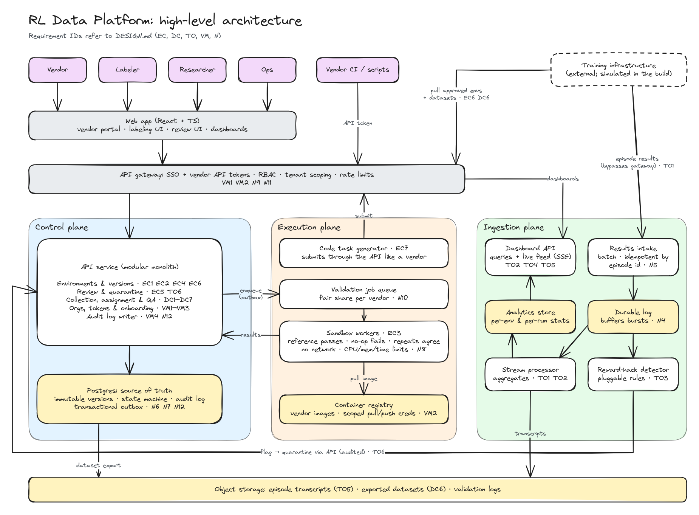

# RL Data Platform: Design

| | |
|---|---|
| Status | Draft: requirements and high-level design. No build scope yet |
| Date | 2026-10-13 |
| Source | [`POSTING.md`](POSTING.md), Anthropic's Full-Stack Software Engineer, Reinforcement Learning posting |

Requirements are derived from the posting and tied back to it by quotation. Anything the posting doesn't say outright is listed in the [Assumptions](#8-assumptions) register and cited by ID (`A#`).

## 1. Problem area

The posting summarizes the job in one sentence: build the platforms, tools and interfaces that power *"environment creation, data collection, and training observability"*. The reason it matters: *"The quality of Claude's next generation depends on the quality of the data we train it on"*.

Put another way: outside contributors (vendors and labelers) produce training environments and human data at scale, and researchers need to trust that output before and during training. The system has three pillars and one cross-cutting layer:

| Pillar | Job |
|---|---|
| Environment creation | Get correct, well-calibrated training environments from vendors (and generators) into training |
| Data collection | Get high-quality human data from thousands of labelers into training |
| Training observability | Show whether environments and runs behave as intended, and catch reward hacks |
| Vendor management and platform (cross-cutting) | Tenancy, access, credentials, onboarding, audit, APIs |

**How the requirements were derived.** The *What You'll Do* (8 bullets) and *Representative Projects* (6 bullets) sections were grouped by the system each bullet describes, then sorted under the three pillars named in the role summary. Items from *Strong Candidates May Also Have* are nice-to-haves. Where one became a requirement, it's marked (A18). One *What You'll Do* bullet (*"Partner closely with RL researchers…"*) describes how the role works, not something to build, so it produced no requirement.

## 2. Actors

| Actor | Who | Source |
|---|---|---|
| Vendor | External partner that builds environments, and (A24) supplies labelers | *"let external partners create, submit, and iterate on training environments"* |
| Labeler | One of thousands of human experts, often non-technical | *"thousands of data labelers"*; *"non-technical labelers"* |
| Researcher | Reviews environments, defines data collection, watches training runs | *"researchers, external vendors, and thousands of data labelers use every day"* |
| Ops / vendor manager | Onboards and manages vendors | *"data operations, and vendor management"* |
| Training infrastructure | System actor: consumes approved environments and data, reports run results (A23) | *"RL training infrastructure"* |

## 3. Functional requirements

### Environment creation

| # | Requirement | Source | Assumes |
|---|---|---|---|
| EC1 | A vendor can define an environment: task prompt, container image, grader or reward function, and metadata (language, intended difficulty) | *"environment configuration"* | |
| EC2 | Every change creates an immutable version; history and diffs are viewable | *"versioning"* | |
| EC3 | Submitting a version triggers automated checks: the reference solution passes, a no-op solution fails, repeated runs agree, and difficulty is estimated | *"validate correctness and difficulty calibration before environments hit production training"* | A11, A12 |
| EC4 | A vendor sees check results and reviewer feedback, then fixes and resubmits | *"iterate on training environments with minimal friction"* | |
| EC5 | A researcher browses environments (filter by status, vendor, difficulty), grades them against a rubric and leaves feedback | *"let researchers browse, grade, and provide feedback on training environments"* | A20 |
| EC6 | Approved versions are promoted and exposed to training infrastructure through an API | *"connect environment authoring tools, data collection systems, and RL training infrastructure"* | A23 |
| EC7 | Programming tasks are generated in bulk across languages and difficulty levels, each with tests as the reward signal, and pass through EC3 | *"scalable code data generation pipelines, producing diverse programming tasks with robust reward signals"* | A21 |

### Data collection

| # | Requirement | Source | Assumes |
|---|---|---|---|
| DC1 | A researcher creates a collection project: task type, instructions, answer schema (rate, compare, write, trajectory review) | *"labeling workflows"*; *"many task types"*; *"complex agentic tasks"* | |
| DC2 | Items are queued and assigned to labelers across vendors | *"human data collection at scale"* | A24 |
| DC3 | Labelers complete items in a UI built for non-technical users | *"interfaces that are intuitive for both technical researchers and non-technical labelers"* | |
| DC4 | QA: gold items with known answers, overlapping assignments to measure agreement, reviewer spot checks, a quality score per labeler | *"quality assurance systems"* | A13 |
| DC5 | Labelers can flag broken items, and disagreement spikes raise alerts | *"feedback mechanisms that surface reward signal integrity issues early"* | A13 |
| DC6 | QA-passed data is exported for training | *"connect environment authoring tools, data collection systems, and RL training infrastructure"* | A23 |
| DC7 | Progress and throughput are tracked per project and per vendor | *"data collection progress"* | |

### Training observability

| # | Requirement | Source | Assumes |
|---|---|---|---|
| TO1 | Ingest per-episode results from runs: environment version, reward, pass/fail, length, transcript reference | *"training run health"* | A23 |
| TO2 | Per-environment stats over time: solve rate, reward variance, difficulty | *"measure environment difficulty"*; *"environment statistics"* | |
| TO3 | Flag suspected reward hacks | *"catch reward hacks"* | A14 |
| TO4 | Live dashboard and alerts while a run is in progress | *"real-time feedback during production training"* | A9 |
| TO5 | Drill down from a run to an environment to a single episode transcript | *"browsing and analyzing training run results"* | |
| TO6 | From a flag, quarantine an environment and send it back to review (EC5) | Inferred: closes the loop from observability back to environment creation | A19 |

### Vendor management and platform

| # | Requirement | Source | Assumes |
|---|---|---|---|
| VM1 | Ops creates vendor orgs, invites users and assigns roles; vendors see only their own data | *"multi-tenant platforms with role-based access"* (nice-to-have) | A18 |
| VM2 | Vendors manage scoped API tokens and container registry credentials: create, rotate, revoke | *"Docker registry access, API token management"* | |
| VM3 | Self-serve onboarding checks setup: token works, image pushes, sample environment passes | *"onboarding automation and documentation tooling so new vendors and internal users ramp up in hours, not weeks"* | A22 |
| VM4 | Every state change is recorded with who, what and when | *"audit trails"* (nice-to-have) | A18 |
| VM5 | Everything in the UI is also available through the API | *"backend services and APIs"* | |

## 4. Core flows

Three flows carry most of the value. They share one central entity, the **environment version**.

1. **Submit → validate → review → approve** (EC1–EC6)
2. **Collect → QA → export** (DC1–DC6)
3. **Run → monitor → flag → quarantine** (TO1–TO6), which loops back into flow 1

## 5. Scale estimate

| Load | Inputs | Math | Conclusion |
|---|---|---|---|
| Labeling | 5,000 active labelers (A1), 30 items/hour over 8-hour days (A2) | 5k × 30 × 8 ≈ 1.2M submissions/day ≈ 14/s average, ~50/s peak | Modest. One Postgres handles it |
| Validation | 50 vendors (A3), 5k version submissions/day (A4), 5 sandbox runs of ~5 min each (A5) | 25k runs × 5 min ≈ 125k container-minutes/day ≈ 90 containers running at once | Compute is the bottleneck, not the API |
| Training results | 1k episodes/s peak across runs (A6); ~1 KB metadata plus 100 KB–1 MB transcript each (A7) | ~1 MB/s metadata; 100 GB+/day of transcripts | The heaviest write path. Transcripts go in object storage, metadata in an analytics store |

The system is light on reads, heavy on writes for training results, and compute-heavy for validation. Those three loads need separate paths.

## 6. Non-functional requirements

| # | Quality | Requirement | Why | Assumes |
|---|---|---|---|---|
| N1 | Latency (labelers) | UI actions < 200 ms p95; the next item loads in < 1 s | Labelers are paid by time, so friction is a direct cost | A10 |
| N2 | Latency (feedback) | Validation results within minutes; dashboard data 10–30 s behind training | *"real-time feedback during production training"*; *"a loop that closes in hours and days"* | A9 |
| N3 | Availability | Labeling 99.9%; vendor portal 99.5%; dashboards may degrade | An outage idles thousands of paid people; dashboards are read-only, so brief staleness is acceptable | A8 |
| N4 | Decoupling | Training infrastructure is never blocked by this platform; results are buffered and processed asynchronously | Losing visibility is acceptable; stalling training isn't | A23 |
| N5 | Durability | No submitted label or episode result is lost; processing is idempotent (safe to retry) | *"The quality of Claude's next generation depends on the quality of the data we train it on"* | |
| N6 | Reproducibility | Environment versions are immutable; every episode and dataset references an exact version | An approved environment can't change under a running training job | |
| N7 | Consistency | Strong for state changes (approve, quarantine, assign); eventual for aggregates and dashboards | Double-assigned items or double approvals corrupt QA; a stats lag doesn't | |
| N8 | Isolation of vendor code | Sandboxed runs: no network, CPU/memory/time limits, killed on timeout | Vendors submit arbitrary containers | A15 |
| N9 | Tenant isolation | Vendors see only their own data; labelers never see gold answers; vendors never see held-out evaluation data | *"multi-tenant platforms with role-based access"*; leaked gold answers let QA be gamed | A16, A18 |
| N10 | Fairness between tenants | Per-vendor quotas and fair queueing for validation compute | One vendor flooding submissions mustn't starve the rest | A17 |
| N11 | Credential security | Tokens are scoped, hashed at rest, rotatable and revocable | *"API token management"* | |
| N12 | Audit and lineage | Append-only change log; any episode traces back to its environment version, vendor and reviewer | *"audit trails"*; the trace is how a *"reward signal integrity"* issue is pinned to its source | A18 |
| N13 | Adaptability | New task types and environment schemas ship without a database migration (schema-driven forms and configs); deploys happen many times a day | *"priorities shift"*; *"many task types"*; *"react to what researchers need next"* | |
| N14 | Fast onboarding | A new vendor goes from invite to first passing environment in < 1 day, without help | *"ramp up in hours, not weeks"* | A22 |
| N15 | Monitoring the platform itself | Metrics and alerts on queue backlog, sandbox failure rate, ingestion lag | A dashboard that silently goes stale is worse than none | |

## 7. Out of scope

- Actually training models. Training infrastructure is simulated by a script that pulls approved environments and sends episode results (A23).
- Grading with a model (LLM-as-judge).
- Paying vendors or labelers.

## 8. Assumptions

Each assumption names the requirements that depend on it and what changes if it's wrong.

### Numbers

| ID | Assumption | Used by | If wrong |
|---|---|---|---|
| A1 | ~5,000 labelers are active on a given day (posting says *"thousands"*) | Scale estimate, N1, N3 | 10× more still fits one Postgres for labeling writes (~500/s peak); revisit at 100× |
| A2 | A labeler completes ~30 items/hour over an 8-hour day | Scale estimate | Long agentic items could be 2–5/hour, which cuts write load and raises the cost of losing a submission (N5) |
| A3 | ~50 vendor orgs | Scale estimate, N10 | Fairness (N10) matters more with fewer, larger vendors |
| A4 | ~5,000 environment versions submitted per day | Scale estimate | Validation compute scales linearly with this |
| A5 | Each submission takes ~5 sandbox runs (reference, no-op, 3 repeats) of ~5 min each | Scale estimate, EC3 | Longer agentic environments (hours) would need far more compute and partial or sampled validation |
| A6 | ~1,000 episodes/s at peak across concurrent training runs | Scale estimate, N4 | 10× more would require a streaming log (e.g. Kafka) in front of ingestion instead of a simple queue |
| A7 | Episode metadata ~1 KB; transcripts 100 KB–1 MB | Scale estimate | Bigger transcripts change storage cost, not the design, as long as they stay in object storage |
| A8 | Availability targets: labeling 99.9%, vendor portal 99.5% | N3 | Chosen to rank surfaces by cost of downtime, not taken from the posting |
| A9 | "Real-time" means 10–30 s behind training | N2, TO4 | Sub-second would require push or streaming all the way to the browser |
| A10 | Labeler latency targets of 200 ms p95 and < 1 s to next item | N1 | Industry-typical UI targets, not from the posting |

### Inferred checks and signals

| ID | Assumption | Used by | If wrong |
|---|---|---|---|
| A11 | An environment whose grader passes a no-op or empty solution has a broken reward signal and should fail validation | EC3 | Drop the check; reward hacks would then be caught only after training (TO3) |
| A12 | An environment must give the same result for the same solution across repeated runs | EC3 | Some environments are stochastic by design; would need a tolerance instead of exact agreement |
| A13 | Labeler quality is measured partly by overlapping assignments (several labelers on one item) and agreement between them | DC4, DC5 | Gold items and spot checks alone; costs less labeler time but catches less |
| A14 | Reward-hack signals include full reward on unusually short episodes, edits to test or grader files, and sudden jumps in solve rate | TO3 | The real signals are domain knowledge to learn from researchers; the detector should be pluggable |
| A15 | Vendor environments are arbitrary, untrusted containers (inferred from *"Docker registry access"*) | N8 | If vendors only submit configs for trusted runtimes, sandboxing gets much simpler |
| A16 | Held-out evaluation data exists and must not reach vendors | N9 | Remove the constraint |
| A17 | Vendors compete for shared validation compute | N10 | Per-vendor dedicated capacity would remove the need for fair queueing |

### Interpretation calls

| ID | Assumption | Used by | If wrong |
|---|---|---|---|
| A18 | Multi-tenancy and audit trails are required, though the posting lists them as nice-to-haves | VM1, VM4, N9, N12 | Both are cheap to design in and expensive to add later, so they stay unless scope forces a cut |
| A19 | A flag in observability should be able to quarantine an environment | TO6 | The posting stops at "catch"; without TO6 the pillars don't connect |
| A20 | Researchers reviewing environments and labelers producing data are separate workflows with separate users | EC5, DC1–DC5 | They could share a generic task-and-review engine, which would cut build effort |
| A21 | Generated programming tasks go through the same validation as vendor environments | EC7 | A separate pipeline would duplicate EC3 |
| A22 | "Hours, not weeks" onboarding means under a day, end to end, without help | VM3, N14 | |
| A23 | Training infrastructure is a separate system: it pulls approved environments and data and pushes episode results | EC6, DC6, TO1, N4 | If it's tightly coupled, ingestion could read from its storage instead of receiving pushes |
| A24 | The same vendor model covers environment builders and labeling suppliers | Actors, DC2 | Two vendor types would need separate onboarding and roles |

## 9. High-level design

Source: [`diagrams/architecture.excalidraw`](diagrams/architecture.excalidraw) (open at excalidraw.com, edit, then re-export the PNG).

The system splits into three planes, because the scale estimate shows three loads that behave differently: low-volume state changes that must be correct, compute-heavy validation, and a high-volume stream of training results.

### Components

| Component | Plane | Job | Requirements |
|---|---|---|---|
| Web app | Edge | One React + TS app with four surfaces: vendor portal, labeling UI, review UI, dashboards | EC4 EC5 DC3 TO4 TO5 |
| API gateway | Edge | Authenticates (SSO for staff and labelers, API tokens for vendors and services), applies roles and tenant scoping, rate-limits | VM1 VM2 N9 N11 |
| API service | Control | One service split into modules: environments and versions, review and quarantine, collection and QA, orgs and tokens, audit | EC1–EC6 DC1–DC7 VM1–VM5 TO6 |
| Postgres | Control | Source of truth: immutable versions, the version state machine, assignments, the audit log, and an outbox table for jobs | N6 N7 N12 |
| Validation job queue | Execution | Holds validation jobs; hands them out with a fair share per vendor | N10 |
| Sandbox workers | Execution | Run each submitted version: reference solution must pass, no-op must fail, repeat runs must agree, difficulty estimated. No network; CPU, memory and time limits | EC3 N8 |
| Container registry | Execution | Vendor images, with per-vendor push and pull credentials | VM2 |
| Code task generator | Execution | Generates programming tasks and submits them through the public API, like any vendor | EC7 A21 |
| Results intake | Ingestion | Accepts batches of episode results from training; deduplicates by episode id; acknowledges once written to the log | TO1 N5 |
| Durable log | Ingestion | Buffers bursts so training is never slowed by downstream processing | N4 |
| Stream processor | Ingestion | Aggregates per-environment and per-run stats; writes transcripts to object storage | TO1 TO2 |
| Reward-hack detector | Ingestion | Pluggable rules over the episode stream; raises flags through the API | TO3 A14 |
| Analytics store | Ingestion | Stats tables built for time-range queries (e.g. ClickHouse) | TO2 |
| Dashboard API | Ingestion | Queries for dashboards and drill-down, plus a live feed over server-sent events | TO2 TO4 TO5 |
| Object storage | Shared | Episode transcripts, exported datasets, validation logs | TO5 DC6 |

### Key decisions

| # | Decision | Why | Trade-off |
|---|---|---|---|
| D1 | The control plane is one modular service, not microservices | Priorities shift fast (N13); one deploy and one database keep iteration quick | Modules must keep clean boundaries so the ingestion or execution side can split off later |
| D2 | State change and job creation are written in one Postgres transaction (outbox), and a relay moves outbox rows to the queue | A version can't end up "submitted" with no validation job, or a job for a version that was rolled back (N5, N7) | Adds a relay process and at-least-once delivery, so workers must be idempotent |
| D3 | Environment versions are immutable, and their status changes only through a state machine (draft → submitted → validating → failed or in review → approved → quarantined) | Training always refers to an exact, unchanging version (N6); every transition is a single audited event (N12) | Fixing a typo means a new version |
| D4 | Validation runs in sandboxes pulled from a fair-share queue | Vendor code is untrusted (N8, A15); one vendor can't starve the rest (N10) | Sandboxing (e.g. gVisor or Firecracker) adds startup time to each run |
| D5 | Training results bypass the gateway and the control plane: intake → durable log → processors | Training is never blocked by the platform (N4); the heaviest write path stays off the control database | Two paths to secure and monitor; dashboards are eventually consistent (N7) |
| D6 | Intake deduplicates by episode id, and every processor is idempotent | Retries can't double-count results (N5) | Producers must assign stable episode ids |
| D7 | The hack detector raises flags through the API, not by writing to the database directly | Quarantine goes through the same state machine and audit trail as a human decision (TO6, VM4) | One extra network hop on a path that isn't latency-sensitive |
| D8 | Gold answers live in their own table, which labeler-facing endpoints never read | Labelers can't see gold answers, so QA can't be gamed (N9) | QA scoring needs a separate, privileged code path |
| D9 | Task types and environment configs are described by JSON schemas stored as data | New task types ship without a migration or a new UI form (N13) | Validation and rendering are generic, so very custom task UIs need extension points |
| D10 | Training pulls approved environments from a catalog API and downloads datasets via short-lived signed URLs | Training stays decoupled (A23); large files never pass through the API (DC6) | Signed URLs must expire and be scoped to one dataset |

### Core entities

| Entity | Key fields | Notes |
|---|---|---|
| Org | id, name, kind (vendor or internal) | Tenant boundary (VM1) |
| User | id, org, role (vendor, labeler, researcher, ops) | |
| ApiToken | id, org, scopes, hash, expires_at, revoked_at | Stored hashed (N11) |
| Environment | id, org, name | Groups versions |
| EnvironmentVersion | id, environment, number, config (JSON), image digest, status | Immutable; the central entity (D3) |
| ValidationRun | id, version, check (reference, no-op, repeat), result, logs_uri | |
| Review | id, version, reviewer, grade, rubric scores, feedback | |
| CollectionProject | id, task_type schema, instructions, overlap, gold rate | |
| Item / Assignment / Label | item payload; assignment to a labeler; the submitted answer | One open assignment per labeler and item (N7) |
| GoldAnswer | item, answer | Separate table (D8) |
| Dataset | id, project, filter, uri, created_at | An exported snapshot (DC6) |
| TrainingRun / Episode | run; episode_id, version, reward, passed, length, transcript_uri | Episodes live in the analytics store, not Postgres (D5) |
| Flag | id, version, run, rule, evidence, status | Raised by the detector or a person (TO3, TO6) |
| AuditEvent | id, actor, action, entity, before, after, at | Append-only (VM4) |

### API sketch

| Call | Who | Requirements |
|---|---|---|
| `POST /environments`, `POST /environments/{id}/versions` | Vendor | EC1 EC2 |
| `POST /versions/{id}/submit`, `GET /versions/{id}` | Vendor | EC3 EC4 |
| `GET /versions?status=in_review`, `POST /versions/{id}/reviews` | Researcher | EC5 |
| `POST /versions/{id}/approve`, `POST /versions/{id}/quarantine` | Researcher, detector | EC6 TO6 |
| `GET /catalog` | Training | EC6 |
| `POST /projects`, `POST /projects/{id}/items` | Researcher | DC1 DC2 |
| `POST /assignments/next`, `POST /assignments/{id}/label`, `POST /items/{id}/flag` | Labeler | DC2 DC3 DC5 |
| `GET /projects/{id}/quality`, `POST /projects/{id}/exports` | Researcher | DC4 DC6 DC7 |
| `POST /ingest/episodes` (batch) | Training | TO1 N5 |
| `GET /runs/{id}/stats`, `GET /runs/{id}/live` (SSE), `GET /episodes/{id}` | Researcher | TO2 TO4 TO5 |
| `POST /orgs`, `POST /orgs/{id}/invites`, `POST /orgs/{id}/tokens`, `DELETE /tokens/{id}` | Ops, vendor | VM1 VM2 |
| `GET /onboarding/checks` | Vendor | VM3 |

## 10. Next steps

1. **Scope the build**: which flow or flows, the timebox and the stack.
2. **Decide which NFRs get shown in code versus written up.** N4–N9 and N12 are cheap to demonstrate and are the hard parts. The scale targets (N1–N3, N10) are better written up from the estimates above.
3. **Deeper diagrams if needed**: the environment-version state machine (D3) and sequence diagrams for the three core flows.
