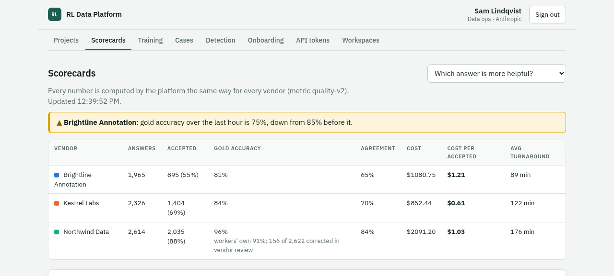
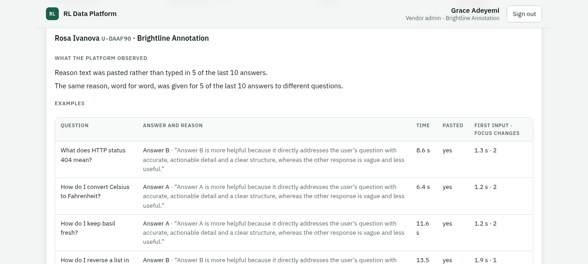
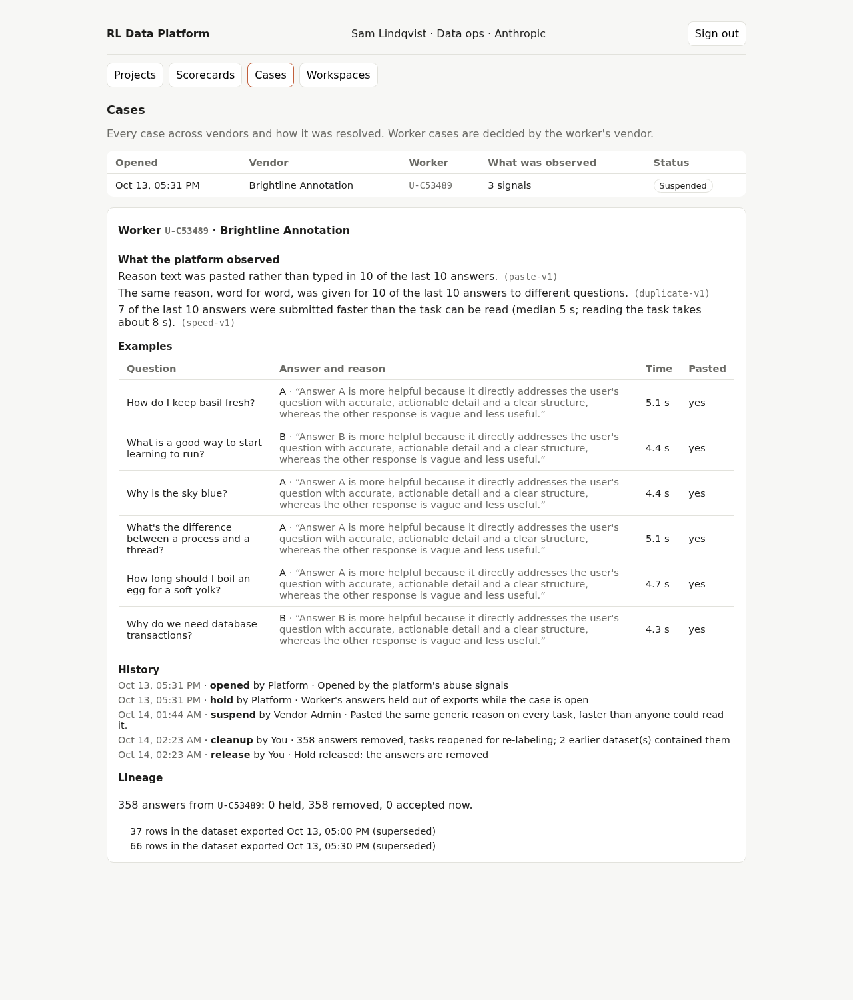
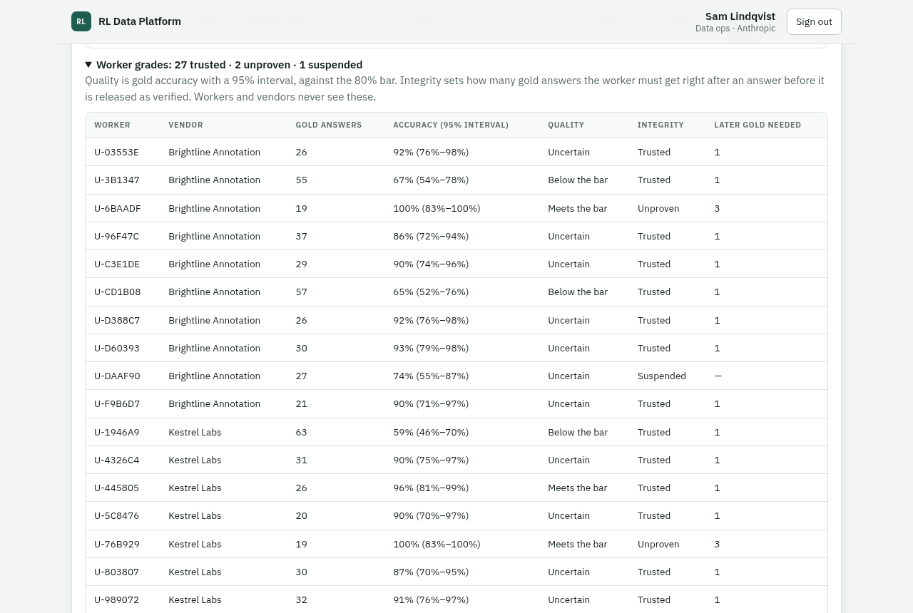

# RL Data Platform

A working slice of a platform for sourcing AI training data through many vendors. Work is split across vendors, every vendor is measured the same way by the platform, and abuse is caught, decided on by a person, and cleaned out of the data, with a trail back to every answer.

Built in response to Anthropic's [Full-Stack Software Engineer, Reinforcement Learning](docs/POSTING.md) posting. Version 0.1.0 is an MVP: it builds the data-collection core of the design, not environments or training observability. [Limitations](docs/LIMITATIONS.md) says what it doesn't do and where it falls short.

**[Watch the 100-second walkthrough](docs/media/walkthrough.mp4)** · [Product requirements](docs/PRD.md) · [Design](docs/DESIGN.md) · [Decisions](docs/DECISIONS.md) · [Build plan](docs/BUILD.md) · [Limitations](docs/LIMITATIONS.md)



## The story `make demo` tells

Three fictional vendors work on one project, *"Which of these two answers is more helpful?"*: 3,000 comparisons, two answers each, 5% hidden test questions (gold tasks). Thirty simulated workers answer through the public API. About five simulated hours run in under three minutes.

1. **Data ops splits the work.** Northwind (40%, $0.80 per task), Kestrel (35%, $38 per hour) and Brightline (25%, $0.55 per task).
2. **Every vendor is measured the same way.** The platform computes gold accuracy, agreement, acceptance, cost per accepted answer and turnaround. No vendor reports its own numbers. Brightline is the cheapest per task and the most expensive per accepted answer.
3. **Halfway through its work, one Brightline worker starts pasting the same generic reason on every task**, faster than anyone could read it. Brightline's gold accuracy and acceptance drop.
4. **The platform notices and opens a case.** A separate detection service reads every submission and reports three signals that agree: speed, pasting and duplicates. The worker's answers are held out of training automatically. Nothing is done *to the worker* yet.
5. **One signal on its own isn't a case.** A careful Northwind worker pastes reasons from their own notes. Pasting alone only puts them on watch, so the platform quietly gives them more test questions. Their good answers clear them, and their vendor never sees a case.
6. **Brightline's admin decides.** She sees what was observed, with examples, but never the rules' thresholds or which tasks were tests. She suspends the worker, with a reason on record.
7. **Data ops cleans up.** Lineage shows every answer the worker gave. None of her pasted answers reached a dataset: the release stage held them back, because the test questions she answered after them were failing. A few honest answers from before she switched may have gone out; nobody can say exactly when abuse begins, so one click removes all her answers and reopens those tasks for other workers.
8. **Every export contains only released answers**: checked by detection, past a minimum gap, and backed by good test answers from the same worker afterwards. How many depends on the worker's grade: a trusted worker needs one, a new one three. Grades rate quality and integrity separately, so an honest but sloppy worker is trusted with low quality, not treated as abusive. Each row is tagged verified or provisional and points back to its source.
9. **The audit log holds the whole chain** and can't be edited, even by direct SQL.

| Brightline's admin: the case | Data ops: lineage and clean-up |
|---|---|
|  |  |



## Run it

Needs Docker with Compose.

```sh
make demo    # fresh database, then the scripted scenario above (about 3 minutes)
make up      # start Postgres, the API, the background worker and the web app on real time
make test    # 108 backend tests (against a separate test database) and 9 detection-service tests
make down    # stop (make reset also deletes the database)
```

Open http://localhost:5173 and pick a demo user. The login page suggests a path through the story. The API is at http://localhost:8000 (interactive docs at `/docs`).

`make demo` plays the people in the story too: the admin's suspension and data ops' clean-up. To make those decisions yourself, run `DEMO_AUTOPILOT=false make demo`, then sign in as Grace Adeyemi (Brightline's admin) and then Sam Lindqvist (data ops).

## What's real and what stands in

| Built | Stand-in for |
|---|---|
| FastAPI service with workspace scoping on every route | The API gateway (SSO, tenant scoping) |
| Seeded demo logins | Real sign-in |
| Postgres job table claimed with `SKIP LOCKED` | A message queue (needless at this load; see [D2](docs/DESIGN.md)) |
| Summary tables in Postgres | An analytics store |
| A Docker volume | Object storage for exported datasets |
| An outbox table the detection service reads through a cursor feed | A message broker between the platform and the detection service ([D24](docs/DESIGN.md)) |
| A demo clock running 180× real time, `make demo` only | Waiting five hours for the story |

Out of scope so far: the environment pipeline (planned as the [environment milestones](docs/BUILD.md#environment-milestones)) and training observability, vendor-level abuse rules, vendor reviewers, and the rest of the design's [integrity layers](docs/DESIGN.md#integrity-layers): audit sampling, shadow mode, and extra overlap and spot checks during escalation. [BUILD.md](docs/BUILD.md#2-scope) lists everything left out and why, and [LIMITATIONS.md](docs/LIMITATIONS.md) covers where the built part falls short.

**On detecting AI-written answers.** The platform doesn't try to tell AI text from human text; that's unreliable. It flags the *behavior* around a submission: answering faster than the task can be read, pasting rather than typing, and giving the same reason to different questions. Honest but sloppy work isn't flagged: it shows up as low quality on the scorecard instead.

## What building it caught

Each of these was found by testing or by looking at the demo's output, fixed, and covered by a test or recorded as a decision:

- **A race in task claiming:** under 12 concurrent workers, a task got three answers when it allowed two. The claiming query's snapshot was older than its lock. Fixed with a recount after locking; a concurrency test with real commits reproduces it.
- **Three ways gold tasks could be recognized.**
  - Picking every 20th task landed on only 3 of 12 questions.
  - Routing gave each vendor a contiguous block, so every vendor's stream ended in a run of test questions.
  - An audit event visible to vendors included the gold count.

  All three are fixed, and D8 now says gold must be indistinguishable by content, position or routing.
- **A noisy alert:** a vendor alert compared against one lucky early period. It now uses a two-proportion test ([D19](docs/DESIGN.md)).

## Where things are

```
backend/     FastAPI app, migrations, background worker (app/jobs.py), the detection contract (app/routes/detection.py), the release stage (app/release.py), contributor grades (app/grades.py), discreet escalation (app/escalation.py), 108 tests
detection/   the separate detection service: abuse rules and severity (rules.py), its state (detector.py), 9 tests
frontend/    React + TypeScript: one app, a view per role
simulator/   the scripted scenario, driving the public API
docs/        posting, glossary, PRD, design, decisions, build plan, diagrams, media
```
