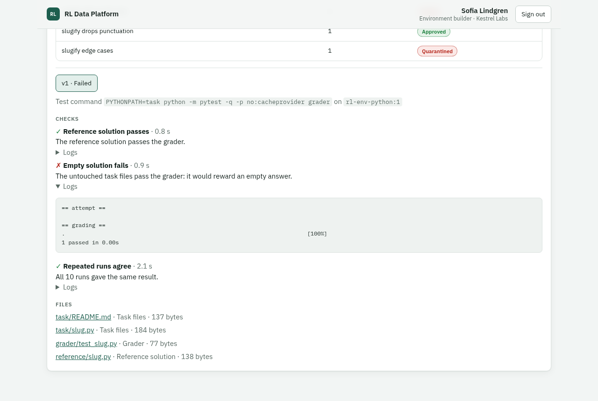

# RL Data Platform

A working slice of a platform for sourcing AI training data through many vendors. Work is split across vendors, every vendor is measured the same way by the platform, and abuse is caught, decided on by a person, and cleaned out of the data, with a trail back to every answer. Vendors also build training environments to a researcher's brief, and the platform checks each one in a sandbox before anyone reviews it or training uses it. When training uses them, the platform watches the results, catches an environment being gamed, and tells training which runs to roll back. New vendors onboard themselves, with API tokens and their own container images, and a code task generator produces programming tasks through the same pipeline.

Built in response to Anthropic's [Full-Stack Software Engineer, Reinforcement Learning](docs/POSTING.md) posting. It builds the data-collection core of the design and thin slices of environment creation and training observability, with training itself played by a stand-in. [Limitations](docs/LIMITATIONS.md) says what it doesn't do and where it falls short.

**[Watch the eight-minute walkthrough](docs/media/walkthrough.mp4)** · [Product requirements](docs/PRD.md) · [Design](docs/DESIGN.md) · [Decisions](docs/DECISIONS.md) · [Build plan](docs/BUILD.md) · [Limitations](docs/LIMITATIONS.md) · [What we chose not to solve](docs/NOT-SOLVED.md) · [Vendor guide](docs/VENDOR-GUIDE.md) · [Operations runbook](docs/OPERATIONS.md)


## The story `make demo` tells

Three fictional vendors work on one project, *"Which of these two answers is more helpful?"*: 3,000 comparisons, two answers each, 5% hidden test questions (gold tasks). Thirty simulated workers answer through the public API. About five simulated hours run in under three minutes.

1. **Data ops splits the work.** Northwind (40%, $0.80 per task), Kestrel (35%, $38 per hour) and Brightline (25%, $0.55 per task).
2. **Every vendor is measured the same way.** The platform computes gold accuracy, agreement, acceptance, cost per accepted answer and turnaround. No vendor reports its own numbers. Brightline is the cheapest per task and the most expensive per accepted answer.
3. **Northwind checks its own workers' answers first.** Its reviewer accepts or corrects each answer before it reaches Anthropic. A correction is kept beside the worker's own answer: Northwind is scored on what it submitted, its workers on what they answered (96% and 91% gold accuracy in one run), so a vendor's review can't hide a worker's mistakes or abuse.
4. **Halfway through its work, one Brightline worker starts pasting the same generic reason on every task**, faster than anyone could read it. Brightline's gold accuracy and acceptance drop.
5. **The platform notices and opens a case.** A separate detection service reads every submission and reports three signals that agree: speed, pasting and duplicates. The worker's answers are held out of training automatically. Nothing is done *to the worker* yet.
6. **One signal on its own isn't a case.** A careful Northwind worker pastes reasons from their own notes. Pasting alone only puts them on watch, so the platform quietly gives them more test questions. Their good answers clear them, and their vendor never sees a case.
7. **Detection is measured, and new rules prove themselves first.** Every spot check also asks whether the answer looks like abuse, and a random share of answers is mixed into the queue so reviewers can't tell audits apart. A new rule that flags very short reasons runs in shadow: it flags more than a dozen honest workers, reviewers judge none of its flags abusive, and it never reaches a vendor. The audit sample finds no abuse the live rules missed.
8. **Workers flag broken tasks.** A bug made both answers identical in the project's last batch of tasks. Workers who reach them flag them instead of answering, and a task two workers flag stops being routed; the researcher retires it, and its answers count nowhere. About a third of the batch was answered by workers who didn't flag it. The agreement alert, which compares a batch with what the same workers achieve on other tasks, stays quiet: those workers disagree a lot everywhere. It also stays quiet through breaks and through the paster, which a simpler alert mistook for broken tasks.
9. **Brightline's admin decides.** She sees what was observed, with examples, but never the rules' thresholds or which tasks were tests. She suspends the worker, with a reason on record.
10. **Data ops cleans up.** Lineage shows every answer the worker gave. None of her pasted answers reached a dataset: the release stage held them back, because the test questions she answered after them were failing. A few honest answers from before she switched may have gone out; nobody can say exactly when abuse begins, so one click removes all her answers and reopens those tasks for other workers.
11. **Every export contains only released answers**: checked by detection, past a minimum gap, and backed by good test answers from the same worker afterwards. How many depends on the worker's grade: a trusted worker needs one, a new one three. Grades rate quality and integrity separately, so an honest but sloppy worker is trusted with low quality, not treated as abusive. Each row is tagged verified or provisional and points back to its source.
12. **The audit log holds the whole chain** and can't be edited, even by direct SQL.

### The second act: environments

13. **A researcher writes a brief** for Python bug-fix environments, with constraints (nothing copied from public benchmarks) and a review rubric. Data ops gives it to Kestrel, the vendor set up to build environments.
14. **Kestrel's builder submits four environments.** Each version is stored by hash in three parts: the task files the model works in, the grader, and the reference solution.
15. **The sandbox checks each one** in fresh containers with no network and strict limits, keeping the grader out of the attempt: the reference solution must pass, the untouched task files must fail, and ten repeat runs must agree. Three are stopped: a grader that rewards an empty answer, a task even its own solution can't pass, and a test that passes at random. The builder sees why, with logs.
16. **The researcher grades the sound one against the brief's rubric** and approves it. Training pulls it from the catalog: the task files and grader, never the reference solution.
17. **Later, a researcher spots that the task copies a public benchmark.** Data ops opens a case: the version is quarantined and leaves the catalog at once, and the case lists which training run pulled it. Data ops retires it.

### The third act: training

18. **Kestrel's builder submits two more.** One is sound. The other, "slugify edge cases", has a grader that only checks the empty string, so a function that returns `""` scores full marks. Both pass the sandbox's checks: the reference passes, the untouched task fails, the repeats agree. The researcher approves both; nothing in a review shows the hole.
19. **Training pulls both and starts a run**, sending back every episode with its run, step, reward, length and transcript. Training here is a stand-in with a modeled policy ([B6](docs/BUILD.md#training-observability-milestones)), and the hack is one we planted; a sandbox test proves `return ""` really beats this grader.
20. **Researchers watch the run live:** solve rate, reward variance and attempt length per environment, with drill-down to each transcript. Partway through, the weak environment's solve rate leaps while its attempts shrink from about 40 turns to 4.
21. **A separate hack detector reads the episodes.** At 20% short full-mark attempts it asks a researcher to read transcripts; at 50% it opens a case, and the version is quarantined without a person. The sound environment raises nothing and keeps training.
22. **The case issues a recall** naming the run, the step it first used the version, and where the flagged attempts began. Training reads it, rolls back to the checkpoint before the first flagged step, and reports that; the report lands on the case. The platform never touches a model.
23. **Data ops retires the version.** Kestrel's scorecard shows its environment work, from versions submitted to quarantines, and what happened in training: episodes, solve rate, flagged attempts and recalls.
24. **A vendor-level rule notices.** Two of Kestrel's environments quarantined within 30 days opens a vendor case for data ops. Kestrel doesn't see it until data ops asks it to respond. Kestrel answers, and only then may data ops act: it pauses Kestrel on the brief. The same kind of rule can catch Brightline's fall (accuracy down while volume rose), but on some runs one worker isn't enough to move a whole vendor; data ops clears that case after Brightline's response.

### The fourth act: a vendor onboards itself

25. **Data ops creates a fourth vendor, Harbor Labs, and gets a single-use invite link** for its admin. Harbor's checklist starts empty, and no real work can be allocated to it until it's complete.
26. **Harbor's admin opens the link and creates an API token** for Harbor's CI. The token belongs to Harbor, not to a person: everything it does is recorded under its name.
27. **Harbor's CI does the rest with that token.** It logs in to the platform's container registry, pushes a runtime image to Harbor's own namespace, and submits a sample environment naming it by digest. The first sample fails a check (its grader accepts an empty answer), the checklist says why, and the CI's fix passes. The platform copied the image into its own namespace, so Harbor can't change what was checked.
28. **Harbor's admin adds a worker, who answers the sample tasks.** Samples run on the real path but feed nothing: no scorecard, dataset, review queue or catalog.
29. **The checklist completes itself**, computed from what happened rather than what Harbor reports: 33 simulated minutes from invite to first accepted work and about an hour to ready, in one run. Data ops gives Harbor the bug-fix brief Kestrel was paused on.

### The fifth act: generated tasks

30. **A researcher writes a brief for generated bug-fix tasks, and data ops gives it to the code task generator**, a separate service that signs in with its own API token like any vendor's tooling.
31. **The generator fills the brief from task families**: hand-written templates for a kind of bug, with names, constants and examples varied per task, at three difficulties. Every task carries probes, known-wrong answers such as one that returns the input unchanged, and the sandbox fails any version whose grader a probe passes.
32. **The probes catch a template bug.** One family's tests only check the example in its README, so a function that hard-codes that example scores full marks. Its probe passes, the version fails, and after two such failures the generator stops the family. The sandbox also caught a bug we hadn't planted: one template's untouched task sometimes passed, because Python's set order changes between processes.
33. **A researcher reviews a sample, not the batch:** three of the seven that passed the checks. Approving all three approves the batch; sending one back would have sent the batch back and stopped its family until the template was fixed.
34. **Training uses the generated tasks, and each family is calibrated:** its intended difficulty beside the difficulty measured from training's solve rates. One family matches its labels at every level; the other is easier than intended at every level (its "hard" tasks are solved 93% of the time), which tells the researcher which template to make harder.



| Brightline's admin: the case | Data ops: lineage and clean-up |
|---|---|
|  |  |


## Run it

Needs Docker with Compose. The sandbox runner starts a container for every environment check through your Docker daemon, which is fine on a laptop and nowhere else ([B5](docs/BUILD.md#environment-milestones)).

```sh
make demo    # fresh database, then the scripted scenario above (about 4 minutes)
make up      # start Postgres, the API, the background worker and the web app on real time
make test    # 203 backend tests, 39 detection-service tests, 18 sandbox tests on real containers and the registry, and 19 task-family tests
make down    # stop (make reset also deletes the database)
```

Open http://localhost:5173 and pick a demo user. The login page suggests a path through the story. The API is at http://localhost:8000 (interactive docs at `/docs`).

`make demo` plays the people in the story too: the admin's suspension, data ops' clean-up and vendor cases, and the researcher's environment reviews and broken-task decisions. To make those decisions yourself, run `DEMO_AUTOPILOT=false make demo` and follow the path on the sign-in page; Northwind's reviewer then leaves her last few answers for you as Hana Kowalski.

## Onboard a vendor yourself

With `make up` running, you can be a new vendor and onboard from your own terminal, the way a vendor's CI would. Docker treats `localhost` registries as trusted, so no TLS setup is needed.

1. Sign in as **Sam Lindqvist** (data ops) → Onboarding. Create a vendor that supplies environments (say "Acme Envs") and open the invite link it gives you: you're now its admin.
2. API tokens → create a token with all three scopes, and copy it. The Onboarding tab now shows the commands below with your vendor's values filled in.
3. From the repo's root:

```sh
export RLP_TOKEN=<your token>
echo "$RLP_TOKEN" | docker login localhost:5000 -u ci --password-stdin
printf 'FROM localhost:5000/platform/base:1\n' | docker build -t localhost:5000/vendors/acme-envs/runtime:1 -
docker push localhost:5000/vendors/acme-envs/runtime:1

# A grader that rewards an empty answer: fails the empty check, and the checklist says so
python3 tools/rlp.py submit backend/tests/fixtures/environments/passes_anything --image localhost:5000/vendors/acme-envs/runtime:1
# A sound one passes, and the checklist completes
python3 tools/rlp.py submit backend/tests/fixtures/environments/sound --image localhost:5000/vendors/acme-envs/runtime:1
python3 tools/rlp.py onboarding
```

Back as Sam, Onboarding shows how long it took from invite to ready, and the vendor can now be allocated real work. The [vendor guide](docs/VENDOR-GUIDE.md) is what a vendor reads (in the app, under Guide, with its own values), and the [operations runbook](docs/OPERATIONS.md) is what Anthropic's data ops and researchers use.

## What's real and what stands in

| Built | Stand-in for |
|---|---|
| FastAPI service with workspace scoping on every route | The API gateway (SSO, tenant scoping) |
| Seeded demo logins | Real sign-in |
| Postgres job table claimed with `SKIP LOCKED` | A message queue (needless at this load; see [D2](docs/DESIGN.md)) |
| Summary tables in Postgres | An analytics store |
| A Docker volume | Object storage for exported datasets |
| A training stand-in that pulls approved environments, sends back episodes from a modeled policy, and rolls back when recalled | Training infrastructure and the model being trained ([A23](docs/DESIGN.md), [B6](docs/BUILD.md#training-observability-milestones)) |
| An outbox table the detection service reads through a cursor feed | A message broker between the platform and the detection service ([D24](docs/DESIGN.md)) |
| Docker containers with no network and strict limits, started per check | A hardened sandbox (gVisor or Firecracker) on dedicated hosts ([B5](docs/BUILD.md#environment-milestones)) |
| A registry over plain HTTP on localhost, with token-based credentials | A registry behind TLS, with image scanning and quotas ([D50](docs/DESIGN.md)) |
| Invite links shown to data ops | Invite emails |
| Hand-written task families in Python | Task families at scale, or tasks written by a model ([D48](docs/DESIGN.md)) |
| A demo clock running 180× real time, `make demo` only | Waiting five hours for the story |

Out of scope so far: agentic task types, and extra overlap during escalation. [BUILD.md](docs/BUILD.md#2-scope) lists everything left out and why, and [LIMITATIONS.md](docs/LIMITATIONS.md) covers where the built part falls short.

**On detecting AI-written answers.** The platform doesn't try to tell AI text from human text; that's unreliable. It flags the *behavior* around a submission: answering faster than the task can be read, pasting rather than typing, and giving the same reason to different questions. Honest but sloppy work isn't flagged: it shows up as low quality on the scorecard instead.

## What building it caught

Each of these was found by testing or by looking at the demo's output, fixed, and covered by a test or recorded as a decision:

- **A race in task claiming:** under 12 concurrent workers, a task got three answers when it allowed two. The claiming query's snapshot was older than its lock. Fixed with a recount after locking; a concurrency test with real commits reproduces it.
- **Three ways gold tasks could be recognized.**
  - Picking every 20th task landed on only 3 of 12 questions.
  - Routing gave each vendor a contiguous block, so every vendor's stream ended in a run of test questions.
  - An audit event visible to vendors included the gold count.

  All three are fixed, and D8 now says gold must be indistinguishable by content, position or routing.
- **Two bugs in generated tasks, caught by the platform's own checks.** One task family named a module `numbers`, which the standard library already imports, so its tests failed for the wrong reason. Another sometimes produced a task whose untouched code passed its own tests, because the bug's output (a Python set's order) changes with each process's hash seed; the sandbox's empty check caught it in the demo. The family now uses integers and rules the coincidence out.
- **A noisy alert:** a vendor alert compared against one lucky early period. It now uses a two-proportion test ([D19](docs/DESIGN.md)).

## Where things are

```
backend/     FastAPI app, migrations, background worker (app/jobs.py), the detection contract (app/routes/detection.py), rule modes, the audit sample and detection's measures (app/detection_quality.py, app/routes/detectors.py), broken tasks and agreement alerts (app/routes/task_health.py), vendor rules and vendor cases (app/vendor_oversight.py, app/routes/cases.py), vendor review (app/routes/vendor_review.py), the release stage (app/release.py), contributor grades (app/grades.py), discreet escalation (app/escalation.py), environments and versions (app/environments.py), the sandbox runner (app/sandbox.py), API tokens (app/routes/tokens.py), the registry's token endpoint and image pinning (app/registry.py, app/oci.py), the catalog (app/routes/catalog.py), episode intake and training dashboards (app/routes/training.py), training statistics (app/training_stats.py), the hack-detection contract and recalls (app/routes/hacks.py, app/environment_cases.py), fixture environments (tests/fixtures/environments), 203 tests
sandbox/     the sandbox runner's image and the base image environment checks run on
registry/    the container registry's configuration (vendor images, D50)
detection/   the separate detection services: abuse rules and severity (rules.py), their state (detector.py), the reward-hack detector (hacks.py, hack_service.py), 39 tests
frontend/    React + TypeScript: one app, a view per role
generator/   the code task generator: task families with probes, and the service that submits them through the API (D48)
tools/       rlp.py, the vendor command-line client
simulator/   the scripted scenario, driving the public API, and the training stand-in (training.py)
docs/        posting, glossary, PRD, design, decisions, build plan, vendor guide, operations runbook, diagrams, media
```
