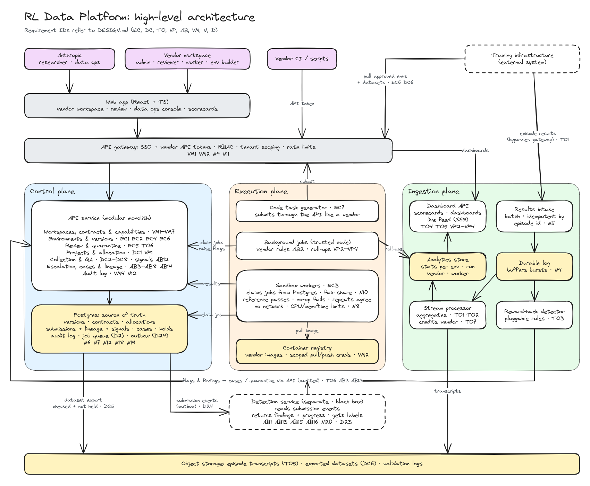

# RL Data Platform: Design

| | |
|---|---|
| Status | Draft: requirements and high-level design. First build scoped in [`BUILD.md`](BUILD.md) |
| Date | 2026-10-13 |
| Source | [`POSTING.md`](POSTING.md), Anthropic's Full-Stack Software Engineer, Reinforcement Learning posting |
| Related | [`PRD.md`](PRD.md) (product requirements) · [`GLOSSARY.md`](GLOSSARY.md) (terms) · [`DECISIONS.md`](DECISIONS.md) (decision register, by reversibility) |

This is the engineering design: *how* the product described in [`PRD.md`](PRD.md) gets built. Requirements are derived from the posting and the PRD, and tied back to them by quotation or capability ID (`C#`). Anything the posting doesn't say outright is listed in the [Assumptions](#8-assumptions) register and cited by ID (`A#`).

## 1. Problem area

The posting summarizes the job in one sentence: build the platforms, tools and interfaces that power *"environment creation, data collection, and training observability"*. The reason it matters: *"The quality of Claude's next generation depends on the quality of the data we train it on"*.

The [PRD](PRD.md) sets out the product problem. Anthropic needs high-quality, high-volume training data and sources it through **vendors**, which differ in what they can supply and how well. Anthropic has to compare vendors on the same work, follow their performance over time, and catch abuse. Vendors have to manage their own people and catch abuse among their own workers.

For engineering, that splits into four areas and one cross-cutting layer:

| Area | Job |
|---|---|
| Environment creation | Get correct, well-calibrated training environments from vendors (and generators) into training |
| Data collection | Get high-quality human data from vendors' workers into training |
| Training observability | Show whether environments and runs behave as intended, catch reward hacks, and attribute training outcomes back to vendors |
| Vendor performance and integrity | Allocate work across vendors, measure every vendor the same way over time, and detect and act on abuse by workers and by vendors |
| Platform (cross-cutting) | Vendor workspaces, access, credentials, onboarding, audit, APIs |

**How the requirements were derived.** The *What You'll Do* (8 bullets) and *Representative Projects* (6 bullets) sections of the posting were grouped by the system each bullet describes and sorted under the areas above. The vendor performance and integrity requirements come from the PRD's capabilities (C1, C4, C5), grounded in the posting's *"vendor management workflows"* and *"quality assurance systems"*. Items from *Strong Candidates May Also Have* are nice-to-haves; where one became a requirement, it's marked (A18). One *What You'll Do* bullet (*"Partner closely with RL researchers…"*) describes how the role works, not something to build, so it produced no requirement.

## 2. Actors

Personas are described in the [PRD](PRD.md#3-who-cares-about-what). Each vendor has a capability setting: human work, environments, or both (A24).

| Actor | Side | Role on the platform | Source |
|---|---|---|---|
| Researcher | Anthropic | Defines projects, reviews environments and data, watches training runs | *"researchers, external vendors, and thousands of data labelers use every day"* |
| Data ops | Anthropic | Sets up vendors, allocates work, compares performance, handles vendor abuse | *"data operations, and vendor management"* |
| Vendor admin | Vendor | Manages the vendor's users and quality; handles worker abuse | *"vendor management workflows"* |
| Vendor reviewer | Vendor | Checks workers' output before it goes to Anthropic (some vendors only) | PRD C2.2 (A29) |
| Worker | Vendor | A labeler or expert doing tasks | *"thousands of data labelers"*; *"non-technical labelers"* |
| Environment builder | Vendor | Creates and submits environments | *"let external partners create, submit, and iterate on training environments"* |
| Training infrastructure | System | Consumes approved environments and data; reports run results (A23) | *"RL training infrastructure"* |

## 3. Functional requirements

### Environment creation

| # | Requirement | Source | Assumes |
|---|---|---|---|
| EC1 | An environment builder can define an environment: task prompt, container image, grader or reward function, and metadata (language, intended difficulty) | *"environment configuration"* | |
| EC2 | Every change creates an immutable version; history and diffs are viewable | *"versioning"* | |
| EC3 | Submitting a version triggers automated checks: the reference solution passes, a no-op solution fails, repeated runs agree, and difficulty is estimated | *"validate correctness and difficulty calibration before environments hit production training"* | A11, A12 |
| EC4 | An environment builder sees check results and reviewer feedback, then fixes and resubmits | *"iterate on training environments with minimal friction"* | |
| EC5 | A researcher browses environments (filter by status, vendor, difficulty), grades them against a rubric and leaves feedback | *"let researchers browse, grade, and provide feedback on training environments"* | A20 |
| EC6 | Approved versions are promoted and exposed to training infrastructure through an API | *"connect environment authoring tools, data collection systems, and RL training infrastructure"* | A23 |
| EC7 | Programming tasks are generated in bulk across languages and difficulty levels, each with tests as the reward signal, and pass through EC3 | *"scalable code data generation pipelines, producing diverse programming tasks with robust reward signals"* | A21 |

### Data collection

| # | Requirement | Source | Assumes |
|---|---|---|---|
| DC1 | A researcher creates a collection project: task type, instructions, answer schema (rate, compare, write, trajectory review), quality bar, volume and deadline | *"labeling workflows"*; *"many task types"*; *"complex agentic tasks"* | |
| DC2 | Tasks are assigned to workers within the vendors allocated to the project (VP1) | *"human data collection at scale"* | |
| DC3 | Workers complete tasks in a UI built for non-technical users, and see feedback on their rejected work: reviewer rejections with the reviewer's reasons. Gold-task results are never shown per task (PRD PD2) | *"interfaces that are intuitive for both technical researchers and non-technical labelers"*; PRD C2.1 | |
| DC4 | QA: gold tasks with known answers (rotated regularly), overlapping assignments to measure agreement, reviewer spot checks, and a quality score per worker, computed the same way for every vendor (N16) | *"quality assurance systems"* | A13 |
| DC5 | Workers can flag broken tasks, and disagreement spikes raise alerts | *"feedback mechanisms that surface reward signal integrity issues early"* | A13 |
| DC6 | QA-passed data is exported for training | *"connect environment authoring tools, data collection systems, and RL training infrastructure"* | A23 |
| DC7 | Progress and throughput are tracked per project and per vendor | *"data collection progress"* | |
| DC8 | A vendor reviewer can check and correct workers' output before it's submitted to Anthropic. Vendor review adds to platform QA and doesn't replace it | PRD C2.2 | A29 |
| A30 | Per-task contracts pay for every submitted answer, not only accepted ones; hourly contracts pay for time on task | VP2, VP3, D11 | If vendors are paid only for accepted work, cost per accepted unit equals the contract price and stops reflecting quality; the comparison would then lean on acceptance rate instead |
| DC9 | The platform records time on task (assignment to submission) for every submission | PRD C3.5; PRD PD3 | |

### Training observability

| # | Requirement | Source | Assumes |
|---|---|---|---|
| TO1 | Ingest per-episode results from runs: environment version, reward, pass/fail, length, transcript reference | *"training run health"* | A23 |
| TO2 | Per-environment stats over time: solve rate, reward variance, difficulty | *"measure environment difficulty"*; *"environment statistics"* | |
| TO3 | Flag suspected reward hacks | *"catch reward hacks"* | A14 |
| TO4 | Live dashboard and alerts while a run is in progress | *"real-time feedback during production training"* | A9 |
| TO5 | Drill down from a run to an environment to a single episode transcript | *"browsing and analyzing training run results"* | |
| TO6 | From a flag, quarantine an environment and send it back to review (EC5) | Inferred: closes the loop from observability back to environment creation | A19 |
| TO7 | Training outcomes (reward hacks, solve rates) are attributed to the environment version and its vendor, and feed the vendor scorecard (VP3) | PRD C3.4; *"surface reward signal integrity issues early"* | |

### Vendor performance

| # | Requirement | Source | Assumes |
|---|---|---|---|
| VP1 | Data ops allocates a project across vendors whose capabilities match, and changes the allocation while it runs | PRD C1.2; *"vendor management workflows"* | A24 |
| VP2 | Project view: vendors side by side on one project, comparing quality, volume, cost per accepted unit and turnaround. Hourly contracts are converted using time on task (DC9) | PRD C4.1; PRD PD3 | |
| VP3 | Vendor scorecard: one vendor's performance over time, across its projects and its environment work, with alerts on significant drops. Environment work is scored on validation pass rate, review grades and training outcomes (TO7) | PRD C4.2; PRD PD3 | |
| VP4 | Vendor's own view: vendor admins see their scorecard as Anthropic sees it, broken down by worker, with each worker's quality history. Reviewer feedback and agreement are live; gold-task accuracy appears only as a per-worker running score after ~20 gold results, refreshed daily | PRD C4.3, C4.4; PRD PD2 | |

### Abuse

| # | Requirement | Source | Assumes |
|---|---|---|---|
| AB1 | Detect worker abuse (answering faster than reading time, near-duplicate answers, AI-generated text where human judgment is required, colluding answer patterns, gold-task farming) and flag it to the vendor admin, using the shared platform rules | PRD C5.1; *"surface reward signal integrity issues early"* | A27 |
| AB2 | Detect vendor abuse (quality falling while volume rises, removed workers returning, environments with gameable graders or copied benchmark content) and flag it to data ops, using the shared platform rules | PRD C5.2; PRD PD1 | A27 |
| AB3 | An abuse flag opens a case with its evidence; low-quality signals feed scorecards and feedback and don't open cases. The owner records a decision: the vendor admin for worker cases, data ops for vendor and environment cases | PRD C5.3 | |
| AB4 | Actions on workers: warn, retrain, suspend, remove | PRD C5.4 | |
| AB5 | Actions on vendors: lower allocation, pause, offboard, each after the vendor has had a chance to respond | PRD C5.5 | |
| AB6 | Clean-up: find everything a flagged worker, vendor or environment version produced (lineage), then discard, re-label or quarantine it | PRD C5.6; *"audit trails"* | |
| AB7 | Data ops can see vendors' worker-abuse cases and how they were resolved | PRD C5.7; PRD PD1 | |
| AB8 | While a case is open, the subject's data is protected automatically and reversibly: a worker's unexported submissions are held out of exports, an environment version is quarantined. Actions against people or vendors (AB4, AB5) always need a recorded human decision | PRD C5.8; PRD PD4 | |
| AB9 | Vendors can add private abuse rules that open cases only inside their own workspace and never feed scorecards (P2) | PRD C5.9; PRD PD5 | |
| AB10 | Cross-vendor worker match: vendors submit a keyed hash of a stable identifier, and matches across vendors become case evidence, never an automatic action (P2) | PRD C5.10; PRD PD1 | |

### Workspaces and platform

| # | Requirement | Source | Assumes |
|---|---|---|---|
| VM1 | Data ops creates vendor workspaces; vendor admins invite users and assign roles (admin, reviewer, worker, environment builder); vendors see only their own data | *"multi-tenant platforms with role-based access"* (nice-to-have) | A18 |
| VM2 | Vendors manage scoped API tokens and container registry credentials: create, rotate, revoke | *"Docker registry access, API token management"* | |
| VM3 | Self-serve onboarding checks setup for the vendor's capabilities: for human work, workers are invited and a sample task is completed and accepted; for environments, the API token works, an image pushes and a sample environment passes validation | *"onboarding automation and documentation tooling so new vendors and internal users ramp up in hours, not weeks"* | A22 |
| VM4 | Every state change is recorded with who, what and when: configuration and decisions in the append-only audit log; work (assignments and submissions) in its own immutable records | *"audit trails"* (nice-to-have) | A18 |
| VM5 | Everything in the UI is also available through the API | *"backend services and APIs"* | |
| VM6 | Data ops sets each vendor's capabilities (human work, environments, or both, plus domains), which decide what it can be allocated | PRD C1.2 | A24 |
| VM7 | Data ops records each vendor's contracts: the kind of work (human work or environments), price, price unit (per hour, per task or per environment) and effective dates. A vendor can hold several, and allocations point to one | PRD PD3 | |

## 4. Core flows

Five flows carry most of the value. Two entities anchor them: the **vendor workspace** (who supplied the work) and the **environment version** or **task** (what was supplied). Lineage links every piece of training data to both.

1. **Submit → validate → review → approve** (EC1–EC6)
2. **Allocate → collect → QA → export** (VP1, DC1–DC8)
3. **Run → monitor → flag → quarantine** (TO1–TO7), which loops back into flow 1
4. **Measure → compare → reallocate** (VP2–VP4, TO7): every vendor scored the same way, per project and over time
5. **Detect → case → act → clean up** (AB1–AB7), at two levels: vendors over their workers, Anthropic over vendors

## 5. Scale estimate

| Load | Inputs | Math | Conclusion |
|---|---|---|---|
| Labeling | 5,000 active labelers (A1), 30 items/hour over 8-hour days (A2) | 5k × 30 × 8 ≈ 1.2M submissions/day ≈ 14/s average, ~50/s peak | Modest. One Postgres handles it |
| Validation | 50 vendors (A3), 5k version submissions/day (A4), 5 sandbox runs of ~5 min each (A5) | 25k runs × 5 min ≈ 125k container-minutes/day ≈ 90 containers running at once | Compute is the bottleneck, not the API |
| Training results | 1k episodes/s peak across runs (A6); ~1 KB metadata plus 100 KB–1 MB transcript each (A7) | ~1 MB/s metadata; 100 GB+/day of transcripts | The heaviest write path. Transcripts go in object storage, metadata in an analytics store |

Worker-abuse checks (AB1) run on labeling submissions, batched per worker every few minutes, so they add well under 14 jobs/s to the job queue (D2). Vendor-level checks (AB2) and scorecards (VP3) are periodic rollups over data already collected.

The system is light on reads, heavy on writes for training results, and compute-heavy for validation. Those three loads need separate paths.

## 6. Non-functional requirements

| # | Quality | Requirement | Why | Assumes |
|---|---|---|---|---|
| N1 | Latency (workers) | UI actions < 200 ms p95; the next item loads in < 1 s | Labelers are paid by time, so friction is a direct cost | A10 |
| N2 | Latency (feedback) | Validation results within minutes; dashboard data 10–30 s behind training | *"real-time feedback during production training"*; *"a loop that closes in hours and days"* | A9 |
| N3 | Availability | Labeling 99.9%; vendor workspace 99.5%; dashboards may degrade | An outage idles thousands of paid people; dashboards are read-only, so brief staleness is acceptable | A8 |
| N4 | Decoupling | Training infrastructure is never blocked by this platform; results are buffered and processed asynchronously | Losing visibility is acceptable; stalling training isn't | A23 |
| N5 | Durability | No submitted label or episode result is lost; processing is idempotent (safe to retry) | *"The quality of Claude's next generation depends on the quality of the data we train it on"* | |
| N6 | Reproducibility | Environment versions are immutable; every episode and dataset references an exact version | An approved environment can't change under a running training job | |
| N7 | Consistency | Strong for state changes (approve, quarantine, assign); eventual for aggregates and dashboards | Double-assigned items or double approvals corrupt QA; a stats lag doesn't | |
| N8 | Isolation of vendor code | Sandboxed runs: no network, CPU/memory/time limits, killed on timeout | Vendors submit arbitrary containers | A15 |
| N9 | Tenant isolation | Vendors see only their own data; Anthropic sees workers only by pseudonymous ID; workers never see gold answers; vendors never see held-out evaluation data | *"multi-tenant platforms with role-based access"*; leaked gold answers let QA be gamed; PRD PD1 | A16, A18 |
| N10 | Fairness between tenants | Per-vendor quotas and fair queueing for validation compute | One vendor flooding submissions mustn't starve the rest | A17 |
| N11 | Credential security | Tokens are scoped, hashed at rest, rotatable and revocable | *"API token management"* | |
| N12 | Audit and lineage | Append-only change log; any episode traces back to its environment version, vendor and reviewer | *"audit trails"*; the trace is how a *"reward signal integrity"* issue is pinned to its source | A18 |
| N13 | Adaptability | New task types and environment schemas ship without a database migration (schema-driven forms and configs); deploys happen many times a day | *"priorities shift"*; *"many task types"*; *"react to what researchers need next"* | |
| N14 | Fast onboarding | A new vendor goes from invite to first accepted work (an accepted sample task or a passing environment) in < 1 day, without help | *"ramp up in hours, not weeks"* | A22 |
| N15 | Monitoring the platform itself | Metrics and alerts on queue backlog, sandbox failure rate, ingestion lag | A dashboard that silently goes stale is worse than none | |
| N16 | Consistent measurement | Quality, volume, cost and turnaround are computed by the platform from its own records, the same way for every vendor. Vendor-reported numbers are never an input | Vendors can only be compared fairly on an identical measure (PRD G2); PRD PD3 | |
| N17 | Detection secrecy | Which tasks are gold, and how abuse detectors work, is never visible to vendors or workers; they see results, not the method. Gold accuracy is shown only in aggregate (VP4) and gold tasks are rotated | Known gold tasks and known rules can be gamed; PRD PD2 | |
| N18 | Due process | Every abuse action is tied to a case holding the evidence behind it, and can be reviewed and reversed | A false finding against a worker or vendor has real consequences (PRD PD4) | |
| N19 | Versioned definitions | Metric definitions, abuse rules and task and config schemas are versioned, and every score, flag, task and config records the version that produced it | A definition can then change without rewriting history: old and new versions can run side by side, and past numbers stay explainable ([decision register](DECISIONS.md)) | |

## 7. Out of scope

- Actually training models. Training infrastructure is an external system (A23). Until a real integration exists, a script stands in for it, pulling approved environments and sending episode results.
- Grading with a model (LLM-as-judge).
- Paying vendors or workers. The platform produces the numbers billing would use.
- Recruiting workers and holding their real identities. Vendors own both (PRD PD1).

## 8. Assumptions

Each assumption names the requirements that depend on it and what changes if it's wrong.

### Numbers

| ID | Assumption | Used by | If wrong |
|---|---|---|---|
| A1 | ~5,000 labelers are active on a given day (posting says *"thousands"*) | Scale estimate, N1, N3 | 10× more still fits one Postgres for labeling writes (~500/s peak); revisit at 100× |
| A2 | A labeler completes ~30 items/hour over an 8-hour day | Scale estimate | Long agentic items could be 2–5/hour, which cuts write load and raises the cost of losing a submission (N5) |
| A3 | ~50 vendor orgs | Scale estimate, N10 | Fairness (N10) matters more with fewer, larger vendors |
| A4 | ~5,000 environment versions submitted per day | Scale estimate, D2 | Validation compute scales linearly with this. At ~1,000× the volume, the job queue should move out of Postgres (D2) |
| A5 | Each submission takes ~5 sandbox runs (reference, no-op, 3 repeats) of ~5 min each | Scale estimate, EC3 | Longer agentic environments (hours) would need far more compute and partial or sampled validation |
| A6 | ~1,000 episodes/s at peak across concurrent training runs | Scale estimate, N4 | 10× more would require a streaming log (e.g. Kafka) in front of ingestion instead of a simple queue |
| A7 | Episode metadata ~1 KB; transcripts 100 KB–1 MB | Scale estimate | Bigger transcripts change storage cost, not the design, as long as they stay in object storage |
| A8 | Availability targets: labeling 99.9%, vendor workspace 99.5% | N3 | Chosen to rank surfaces by cost of downtime, not taken from the posting |
| A9 | "Real-time" means 10–30 s behind training | N2, TO4 | Sub-second would require push or streaming all the way to the browser |
| A10 | Labeler latency targets of 200 ms p95 and < 1 s to next item | N1 | Industry-typical UI targets, not from the posting |

### Inferred checks and signals

| ID | Assumption | Used by | If wrong |
|---|---|---|---|
| A11 | An environment whose grader passes a no-op or empty solution has a broken reward signal and should fail validation | EC3 | Drop the check; reward hacks would then be caught only after training (TO3) |
| A12 | An environment must give the same result for the same solution across repeated runs | EC3 | Some environments are stochastic by design; would need a tolerance instead of exact agreement |
| A13 | Labeler quality is measured partly by overlapping assignments (several labelers on one item) and agreement between them | DC4, DC5 | Gold items and spot checks alone; costs less labeler time but catches less |
| A14 | Reward-hack signals include full reward on unusually short episodes, edits to test or grader files, and sudden jumps in solve rate | TO3 | The real signals are domain knowledge to learn from researchers; the detector should be pluggable |
| A15 | Vendor environments are arbitrary, untrusted containers (inferred from *"Docker registry access"*) | N8 | If vendors only submit configs for trusted runtimes, sandboxing gets much simpler |
| A16 | Held-out evaluation data exists and must not reach vendors | N9 | Remove the constraint |
| A17 | Vendors compete for shared validation compute | N10 | Per-vendor dedicated capacity would remove the need for fair queueing |

### Interpretation calls

| ID | Assumption | Used by | If wrong |
|---|---|---|---|
| A18 | Multi-tenancy and audit trails are required, though the posting lists them as nice-to-haves | VM1, VM4, N9, N12 | Both are cheap to design in and expensive to add later, so they stay unless scope forces a cut |
| A19 | A flag in observability should be able to quarantine an environment | TO6 | The posting stops at "catch"; without TO6 the pillars don't connect |
| A20 | Researchers reviewing environments and workers producing data are separate workflows with separate users | EC5, DC1–DC5 | They could share a generic task-and-review engine, which would cut build effort |
| A21 | Generated programming tasks go through the same validation as vendor environments | EC7 | A separate pipeline would duplicate EC3 |
| A22 | "Hours, not weeks" onboarding means under a day, end to end, without help | VM3, N14 | |
| A23 | Training infrastructure is a separate system: it pulls approved environments and data and pushes episode results | EC6, DC6, TO1, N4 | If it's tightly coupled, ingestion could read from its storage instead of receiving pushes |
| A24 | A vendor supplies human work, environments, or both, and data ops sets each vendor's capabilities rather than vendors declaring their own. The market has both kinds of vendor, and several large ones do both (see [PRD §2](PRD.md#2-problem)) | Actors, VM6, VP1 | If vendors self-declare, a capability needs checking (for example, a trial project) before work is allocated against it |
| A27 | The abuse signals listed in AB1 and AB2 are starting points; real ones come from investigating cases | AB1, AB2 | As with A14, detectors must be pluggable so new signals can be added without a redeploy |
| A29 | Some vendors review their workers' output before submitting it; the platform supports this but doesn't require it | DC8 | If every vendor must review, DC8 becomes a mandatory step in the labeling workflow |

## 9. High-level design

Source: [`diagrams/architecture.excalidraw`](diagrams/architecture.excalidraw) (open at excalidraw.com, edit, then re-export the PNG).

The system splits into three planes, because the scale estimate shows three loads that behave differently: low-volume state changes that must be correct, compute-heavy validation, and a high-volume stream of training results.

### How it works, step by step

**The goal in one line:** Claude improves by practicing tasks and getting scored on them. Anthropic gets many of those tasks, and the human judgments used to score answers, from vendors. A broken task or a careless judgment teaches Claude the wrong lesson, and vendors vary in how often that happens. So the system is a **quality-control line** for training material, a **scoreboard** that measures every vendor the same way, and an **integrity system** that catches abuse and cleans up after it.

Each step lists the components involved, what each one is for, and what breaks without it.

**1. Vendors get a workspace, and only see what's theirs.** Data ops sets up a vendor's workspace, records what it supplies (human work, environments, or both) and enters its contracts: price, and whether it's paid by the hour, the task or the environment. The vendor admin then invites their own reviewers, workers and environment builders, and their scripts get API keys.
- *Web app:* one site with a surface for each role. Without it, vendors and workers, many of them non-technical, would need custom tooling.
- *API gateway:* checks who each request comes from and what they may see. Without it, every part of the system would repeat its own permission checks, and one missed check would expose one vendor's work to another. It can be middleware inside the API service; it's drawn separately to show the responsibility.
- *Workspaces module:* creates workspaces, records capabilities and contracts, invites people, issues and revokes keys. Without it, data ops would set up every vendor by hand, against the posting's *"ramp up in hours, not weeks"*.
- *Pseudonymous worker IDs:* Anthropic sees each worker as an ID, never a name. Vendors keep their workers' identities, so they can work with the platform without handing over personal data.

**2. An environment builder makes a practice task.** They write the task ("fix this bug"), package the code it runs in as a container, and include an answer key: a reference solution plus the grader that scores attempts.
- *Container registry:* stores each vendor's packaged code.
- *Environments module and Postgres:* record the task. Every edit creates a new version, and old versions never change. Without that rule, training would say "I used task #42" and nobody could tell which #42.

**3. Machines check the task before any person spends time on it.** Like checking an exam before giving it: the answer key should score full marks, a blank answer should score zero, and grading the same answer twice should give the same score.
- *Job queue (a Postgres table):* checks take minutes each and thousands arrive a day, so they wait in line. Submitting a task and queueing its checks happen in one database transaction, so a task can never be "submitted" with no check started. Workers take the next job from whichever vendor has the fewest running, so one vendor's 500 submissions can't push everyone else to the back.
- *Sandbox workers:* run the vendor's code in a sealed box with no internet access and strict time and memory limits. Without them, we'd be running strangers' code on our own machines.

**4. A researcher looks at it.** Machines catch tasks that are broken. People catch tasks that work but aren't worth training on: too easy, off-topic, or teaching the wrong skill.
- *Review module:* a queue of tasks for researchers to browse, grade and comment on. Feedback goes back to the environment builder, who fixes the task and resubmits, which sends it back to step 3.

**5. Approved tasks become available to training.**
- *Catalog API:* training asks for "all approved tasks" and gets exact versions. Without it, training would read our database directly, and the two systems couldn't change independently.
- *Code task generator:* creates coding tasks in bulk and submits them through the same front door as a vendor, so they get the same checks. Without that reuse, we'd build and maintain a second quality pipeline.

**6. Data ops splits human-data work across vendors.** A researcher defines a project (such as "compare these pairs of answers, 50,000 of them, by Friday"), and data ops allocates it across vendors that can do that kind of work, each under one of its contracts.
- *Allocation module:* records which vendors get how much of each project, and lets data ops shift work while the project runs. Without it, comparing vendors on the same work would be impossible, because they'd never do the same work.

**7. Workers produce judgments.** Workers at each allocated vendor answer tasks. Some vendors have their own reviewers check the answers before they go to Anthropic.
- *Collection and QA module:* hands out tasks, collects answers, and measures each worker's quality three ways: tasks with known answers (gold), tasks sent to several workers for comparison, and reviewer spot checks. The measurement is identical for every vendor. Workers see why a reviewer rejected their work, but never which of their answers were gold. Without QA, careless or rushed answers go straight into training.
- *Gold answers in a separate table:* workers never see them, vendors never learn which tasks were gold, and the gold set is rotated. Without that, the quality test could be gamed.
- *Lineage on every answer:* each accepted answer records the task, the worker's ID, the vendor and the review. Without it, removing a bad worker's answers later would be guesswork.
- *Object storage (exports):* finished, checked batches are saved as files for training to download.

**8. Training sends back reports.** Every attempt Claude makes on a task produces a report: which task, what score, how long it took, and the full transcript. That's about a thousand reports a second.
- *Results intake:* receives reports in batches and ignores duplicates, so a resent report isn't counted twice.
- *Durable log:* a shock absorber. It accepts reports immediately, even when the parts behind it are slow or down. Without it, a slow dashboard could slow down training, which this system must never do.
- *Separate path that skips the gateway:* this flood never touches the database behind the website, so the site stays fast.
- *Stream processor:* rolls raw reports up into per-task and per-run statistics, and credits each result to the vendor that built the task.

**9. Everyone sees the same scoreboard.** Data ops compares vendors on one project and follows each vendor over time, across both human-data projects and environment work. Each vendor admin sees their own scorecard, the same numbers Anthropic sees, broken down by worker. Reviewer feedback and agreement show up as they happen; gold-task accuracy shows up as a daily running score, so no single task can be identified as a test.
- *Scorecard jobs:* background jobs that roll human-data quality, volume, cost per accepted unit and turnaround up per vendor, per project and per worker. The platform computes every number from its own records; vendors' own reports are never an input. Without that, vendors couldn't be compared fairly.
- *Analytics store:* a database built for questions like "this vendor's acceptance rate by week". Without it, crunching millions of rows in Postgres would slow down everything else on it.
- *Dashboard API:* scorecards, comparisons, run dashboards and a live feed, so researchers can watch a training run as it happens.
- *Object storage (transcripts):* holds full transcripts, which are too big to keep anywhere else.

**10. Catch abuse at both levels, then clean up.** Abuse means making data look better, larger or more human than it is. Vendors police their workers; Anthropic polices vendors.
- *Abuse detection jobs:* rules over workers' answers (answering faster than anyone could read, near-duplicates, AI-written text where a human judgment is required, coordinated answers) and over vendors (quality falling as volume rises, removed workers coming back).
- *Reward-hack detector:* watches the training report stream for a model scoring full marks without solving the problem, such as perfect scores on very short attempts or edits to test files.
- *Cases module:* every flag opens a case with its evidence. Worker cases go to the vendor admin; vendor and environment cases go to data ops, who can also see how vendors handled their own cases. While a case is open, the platform automatically holds the affected data back from training, which can be undone. Every action against a person or vendor, from a warning to offboarding, needs a recorded decision, is tied to its case, and can be reviewed and reversed. Low quality on its own doesn't open a case; it shows up on the scorecard instead.
- *Clean-up through lineage:* once a case is decided, a lineage query finds everything the worker, vendor or environment produced, and it's discarded, re-labeled or quarantined. A quarantined task goes back to review (step 4).

**Throughout: the paper trail.**
- *Audit log:* an append-only record of every approval, allocation, case decision and permission change. When something looks wrong in training, it traces back to the exact task version or answer, the worker and vendor who produced it, and the reviewer who approved it.

### Components

| Component | Plane | Job | Requirements |
|---|---|---|---|
| Web app | Edge | One React + TS app with a surface per role: vendor workspace (admin, reviewer, worker, environment builder), researcher review, data ops console, dashboards and scorecards | EC4 EC5 DC3 DC8 TO4 TO5 VP2–VP4 AB3 |
| API gateway | Edge | Authenticates (SSO for people, API tokens for vendors and services), applies roles and workspace scoping, rate-limits | VM1 VM2 N9 N11 |
| API service | Control | One service split into modules: workspaces, capabilities and contracts, environments and versions, review and quarantine, projects and allocation, collection and QA, cases and actions, lineage and clean-up, audit | EC1–EC6 DC1–DC8 VP1 AB3–AB8 VM1–VM7 TO6 |
| Postgres | Control | Source of truth: immutable versions, the version state machine, contracts, allocations, assignments and submissions with lineage, cases and holds, the audit log, and the job queue (a table) | N6 N7 N12 N18 N19 |
| Job queue | Control (a Postgres table) | Holds validation, abuse-detection and scorecard jobs. Workers claim the next one with `SELECT … FOR UPDATE SKIP LOCKED`; validation jobs are taken from the vendor with the fewest running first | N10 |
| Sandbox workers | Execution | Run each submitted version: reference solution must pass, no-op must fail, repeat runs must agree, difficulty estimated. No network; CPU, memory and time limits | EC3 N8 |
| Background jobs | Execution | Trusted platform code: abuse-detection rules over submissions and vendors, and scorecard roll-ups written to the analytics store | AB1 AB2 VP2–VP4 N16 N17 |
| Container registry | Execution | Vendor images, with per-vendor push and pull credentials | VM2 |
| Code task generator | Execution | Generates programming tasks and submits them through the public API, like any vendor | EC7 A21 |
| Results intake | Ingestion | Accepts batches of episode results from training; deduplicates by episode id; acknowledges once written to the log | TO1 N5 |
| Durable log | Ingestion | Buffers bursts so training is never slowed by downstream processing | N4 |
| Stream processor | Ingestion | Aggregates per-environment and per-run stats, credits outcomes to the environment's vendor, writes transcripts to object storage | TO1 TO2 TO7 |
| Reward-hack detector | Ingestion | Pluggable rules over the episode stream; raises flags through the API, which open cases | TO3 AB3 A14 |
| Analytics store | Ingestion | Stats tables built for time-range queries (e.g. ClickHouse): per environment, run, vendor, project and worker | TO2 TO7 VP2–VP4 |
| Dashboard API | Ingestion | Scorecards, vendor comparisons, run dashboards and drill-down, plus a live feed over server-sent events | TO2 TO4 TO5 VP2–VP4 |
| Object storage | Shared | Episode transcripts, exported datasets, validation logs | TO5 DC6 |

### Key decisions

| # | Decision | Why | Trade-off |
|---|---|---|---|
| D1 | The control plane is one modular service, not microservices | Priorities shift fast (N13); one deploy and one database keep iteration quick | Modules must keep clean boundaries so the ingestion or execution side can split off later |
| D2 | The job queue is a Postgres table. Submitting a version updates its status and inserts its jobs in one transaction; workers claim jobs with `SKIP LOCKED`, then re-check capacity in a fresh statement, because the claiming query's snapshot predates the lock | ~25k validation runs a day is about 0.3 jobs/s (A4, A5), and batched abuse checks add little (§5), far below what Postgres handles. One transaction means a version can't be "submitted" with no job, or have a job after a rollback (N5, N7), with no message broker or outbox relay to run | Workers poll the database, and a crashed worker's job is retried after a lease expires, so jobs must be idempotent. Move to a dedicated broker (with an outbox) only if volume grows ~1,000× |
| D3 | Environment versions are immutable, and their status changes only through a state machine (draft → submitted → validating → failed or in review → approved → quarantined) | Training always refers to an exact, unchanging version (N6); every transition is a single audited event (N12) | Fixing a typo means a new version |
| D4 | Validation runs in sandboxes, taking jobs from the queue with a fair share per vendor | Vendor code is untrusted (N8, A15); one vendor can't starve the rest (N10) | Sandboxing (e.g. gVisor or Firecracker) adds startup time to each run |
| D5 | Training results bypass the gateway and the control plane: intake → durable log → processors | Training is never blocked by the platform (N4); the heaviest write path stays off the control database | Two paths to secure and monitor; dashboards are eventually consistent (N7) |
| D6 | Intake deduplicates by episode id, and every processor is idempotent | Retries can't double-count results (N5) | Producers must assign stable episode ids |
| D7 | Detectors raise flags through the API, not by writing to the database directly | Quarantine and other actions go through the same state machine, cases and audit trail as a human decision (TO6, AB3, VM4) | One extra network hop on a path that isn't latency-sensitive |
| D8 | Gold answers live in their own table, which worker- and vendor-facing endpoints never read. Gold tasks are drawn from the same mix of questions as regular work, and nothing about a task's content, position or routing sets it apart | Workers and vendors can't identify gold tasks, so QA can't be gamed (N9, N17) | QA scoring needs a separate, privileged code path |
| D9 | Task types and environment configs are described by JSON schemas stored as data | New task types ship without a migration or a new UI form (N13) | Validation and rendering are generic, so very custom task UIs need extension points |
| D10 | Training pulls approved environments from a catalog API and downloads datasets via short-lived signed URLs | Training stays decoupled (A23); large files never pass through the API (DC6) | Signed URLs must expire and be scoped to one dataset |
| D11 | Every performance number is computed by the platform, by one code path for all vendors, and vendors read the same numbers Anthropic does | Fair comparison needs an identical measure (N16, VP2, VP3); vendors can only fix what they can see (VP4) | Scorecards lag by the roll-up interval, and gold-task accuracy reaches vendors only as a daily aggregate (PRD PD2) |
| D12 | Workers are pseudonymous outside their vendor: each has a platform ID scoped to the vendor, and identity fields live only in the vendor's workspace | Anthropic can trace data and spot patterns without holding personal data (N9, PRD PD1) | A worker removed by one vendor can't be recognized at another until the keyed-hash match (AB10) is added |
| D13 | One flag → case → action model serves both levels. The case owner follows the subject: worker cases to the vendor admin, vendor and environment cases to data ops | One audited path for every enforcement decision (AB3–AB5, N18, VM4); data ops can review vendors' cases (AB7). Low-quality signals never open cases (PRD PD4) | The case model is generic, so level-specific workflows need care |
| D14 | Lineage is recorded when data is created: every accepted submission stores task, worker ID, vendor, project and review; every dataset row and episode references its source | Clean-up after abuse is a query, not an investigation (AB6, N12) | Wider rows; datasets must be re-exportable without removed items |
| D15 | Abuse detectors are pluggable rules, run as background jobs (AB1, AB2) and over the episode stream (TO3). Shared rules are the only ones that feed scorecards; vendor-private rules (AB9) run inside one workspace. Rule definitions are never exposed through vendor-facing APIs | New signals ship without a redeploy (A27); every vendor is measured by the same rules (N16, PRD PD5); published rules could be gamed (N17) | Vendors see the outcome of a rule, not its logic, which can feel opaque; case evidence (N18) has to make up for it |
| D16 | Data is protected automatically; people are acted on by people. An open case triggers reversible holds (AB8); suspensions, removals and vendor actions need a recorded decision | Damage from abuse is contained within minutes without punishing anyone on a false positive (N18, PRD PD4) | Held data delays exports; a burst of false flags can stall a project until cases are reviewed |
| D17 | Regular tasks are routed to one vendor in proportion to its allocation share, interleaved through the claim order (smooth weighted round-robin); gold tasks are routed to every allocated vendor. Changing an allocation re-routes only tasks nobody has started | Every vendor is measured on the same gold tasks, so gold accuracy is comparable (N16, VP2); interleaving keeps gold evenly mixed into each vendor's stream, where contiguous blocks would end a vendor's stream in a run of gold (D8); work already started stays with the vendor that started it | Gold tasks are answered once per vendor, which costs more than answering them once; agreement on regular tasks is measured within a vendor |
| D18 | Acceptance (metric quality-v1): an answer on a regular task is accepted unless a reviewer rejected it or its worker's gold accuracy is below the project's quality bar, once the worker has enough gold results to judge | Ties accepted volume, and so cost per accepted unit (PRD PD3), to measured quality rather than to volume alone | A worker's later gold results can change whether their earlier answers count; the metric version (N19) makes that explainable |
| D19 | A vendor scorecard raises an alert when gold accuracy over the last hour falls at least 8 points below the vendor's earlier accuracy, and the drop is at least 3 standard errors of the recent window | Data ops needs early warning of real changes (VP3) without chasing noise: a 2-standard-error dip happens by chance in a long series | A small vendor's real drop takes longer to reach significance; worker-level rules (AB1) catch individual abuse sooner |

### Core entities

| Entity | Key fields | Notes |
|---|---|---|
| Org | id, name, kind (vendor or internal), capabilities (human work, environments; domains) | A vendor workspace is a vendor org (VM1, VM6) |
| User | id, org, role (researcher, data ops, vendor admin, vendor reviewer, worker, environment builder), pseudonymous id | Identity fields visible only inside the user's own org (D12) |
| ApiToken | id, org, scopes, hash, expires_at, revoked_at | Stored hashed (N11) |
| Environment | id, org, name | Groups versions |
| EnvironmentVersion | id, environment, number, config (JSON), image digest, status | Immutable (D3) |
| ValidationRun | id, version, check (reference, no-op, repeat), result, logs_uri | |
| Review | id, subject (version or submission), reviewer, grade, rubric scores, feedback | Researcher or vendor reviewer (EC5, DC8) |
| Project | id, task_type schema and schema version, instructions, quality bar, volume, deadline, overlap, gold rate | DC1 |
| Contract | id, vendor, kind of work (human work or environments), price, price unit (hour, task or environment), effective from, effective to | Raw cost inputs (VM7, PRD PD3) |
| Allocation | id, project, vendor, contract, share, status | VP1 |
| TaskRoute | task, vendor | Which vendors may work on a task (D17) |
| Task / Assignment / Submission | task payload; assignment to a worker; the answer, with worker ID, vendor, review, acceptance, time on task and hold status | One open assignment per worker and task (N7); lineage (D14) |
| GoldAnswer | task, answer | Separate table (D8) |
| GoldRetirement | task, retired by, reason, when | Rotation (PRD PD2): retired gold tasks are no longer handed out; past answers on them still count |
| Dataset | id, project, filter, uri, created_at | An exported snapshot (DC6) |
| TrainingRun / Episode | run; episode_id, version, vendor, reward, passed, length, transcript_uri | Episodes live in the analytics store, not Postgres (D5) |
| Flag | id, subject (worker, vendor or version), rule (shared or vendor-private) and rule version, or person; evidence | AB1 AB2 TO3 |
| Case | id, subject, owner, flags, holds, vendor response, status, decision, decided_by | D13, N18 |
| Action | id, case, type (warn, retrain, suspend, remove, lower allocation, pause, offboard, discard, re-label, quarantine) | AB4–AB6 |
| Scorecard row | vendor, work (a project, or the vendor's environment work), worker or environment builder (optional), period, metric version, quality, volume, cost per accepted unit, turnaround | Analytics store (D11) |
| AuditEvent | id, actor, action, entity, before, after, at | Append-only (VM4) |

### API sketch

| Call | Who | Requirements |
|---|---|---|
| `POST /orgs`, `PUT /orgs/{id}/capabilities`, `POST /orgs/{id}/contracts` | Data ops | VM1 VM6 VM7 |
| `POST /orgs/{id}/invites`, `POST /orgs/{id}/tokens`, `DELETE /tokens/{id}`, `GET /onboarding/checks` | Vendor admin | VM1–VM3 |
| `POST /environments`, `POST /environments/{id}/versions`, `POST /versions/{id}/submit`, `GET /versions/{id}` | Environment builder | EC1–EC4 |
| `GET /versions?status=in_review`, `POST /versions/{id}/reviews` | Researcher | EC5 |
| `POST /versions/{id}/approve`, `POST /versions/{id}/quarantine` | Researcher, detector | EC6 TO6 |
| `GET /catalog` | Training | EC6 |
| `POST /projects`, `POST /projects/{id}/tasks` | Researcher | DC1 |
| `POST /projects/{id}/allocations`, `PATCH /allocations/{id}` | Data ops | VP1 |
| `POST /assignments/next`, `POST /assignments/{id}/submit`, `POST /tasks/{id}/flag`, `GET /me/feedback` | Worker | DC2 DC3 DC5 |
| `POST /submissions/{id}/review` | Vendor reviewer | DC8 |
| `GET /projects/{id}/quality`, `POST /projects/{id}/exports` | Researcher | DC4 DC6 DC7 |
| `GET /projects/{id}/vendors` | Data ops, researcher | VP2 |
| `GET /vendors/{id}/scorecard`, `GET /workers/{id}/quality` | Data ops; vendor admin (own vendor only) | VP3 VP4 |
| `GET /cases`, `POST /cases/{id}/responses`, `POST /cases/{id}/decision`, `POST /cases/{id}/actions` | Vendor admin, data ops | AB3–AB5 AB7 AB8 |
| `GET /lineage`, `POST /cleanups` | Data ops | AB6 |
| `POST /ingest/episodes` (batch) | Training | TO1 N5 |
| `GET /runs/{id}/stats`, `GET /runs/{id}/live` (SSE), `GET /episodes/{id}` | Researcher | TO2 TO4 TO5 |

## 10. Next steps

1. **Build the first slice.** [`BUILD.md`](BUILD.md) scopes it: multi-vendor human data (core flows 2, 4 and 5), with the stand-ins listed there.
2. **Next slice after that:** the environment pipeline and training observability (flows 1 and 3), starting with immutable environment versions and sandboxed validation.
3. **Deeper diagrams if needed:** the environment-version state machine (D3), the case life cycle (D13), and sequence diagrams for the five core flows.
